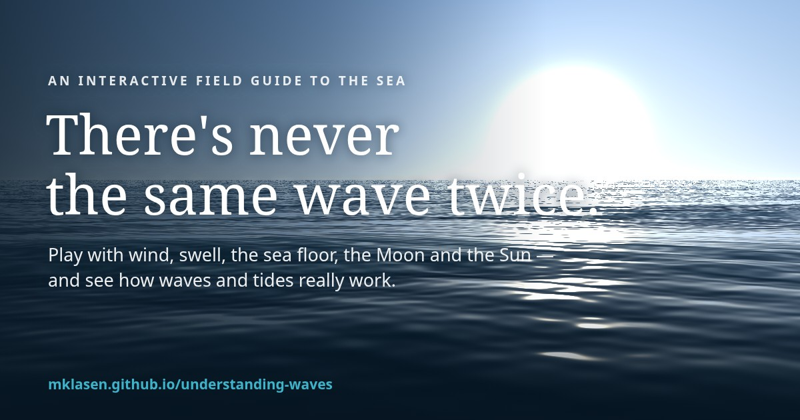

# Understanding Waves

**There's never the same wave twice.** An interactive field guide to ocean waves and tides:
play with the wind, swell, the sea floor, the Moon and the Sun, and see how it all really works.

> **Moved:** this explainer now lives in the [Understanding Nature](https://mklasen.github.io/understanding-nature/) library — **▶ https://mklasen.github.io/understanding-nature/waves/**. The old Pages URL redirects there (the `redirect/` folder is what Pages deploys); this repo keeps the original standalone source.

## Chapters
1. **Every wave is a crowd** — the sea is many waves added together, which is why its exact shape never repeats.
2. **Making waves** — wind speed × duration × fetch → wave height, period and length (JONSWAP / Pierson–Moskowitz), on a live 3D sea.
3. **Energy, not water** — water particles loop in place while the wave moves on; a duck shows Stokes drift.
4. **Swell** — waves from a distant storm sort themselves out: long waves travel faster and arrive first.
5. **Tsunamis** — an earthquake lifts the seafloor; a shallow-water simulation shows jet-speed travel, growth on the shelf and the sea drawing back first.
6. **Tides** — the Moon and Sun stretch the oceans into two bulges; spring and neap tides.
7. **The beach** — shoaling, breaking, breaker types and the tide moving the surf zone, on four seabed shapes.
8. **Ripples** — surface tension vs gravity, from a 1 mm ripple to the tide itself.
9. **Waves, tsunamis and tides** — the difference in one breath.

## How it's built
- A static site in [`site/`](site): vanilla ES modules, a raw-WebGL ocean (48 Gerstner waves) with a
  CPU Canvas2D fallback, no dependencies and no build step.
- Physics model, simplifications and what's next: [DECISIONS.md](DECISIONS.md).
- Deployed to GitHub Pages by [`.github/workflows/pages.yml`](.github/workflows/pages.yml) on every push to `main`.

## Run locally
Any static file server works, e.g. `python3 -m http.server -d site 8000`, or `docker compose up -d`
(nginx with `site/` bind-mounted).
